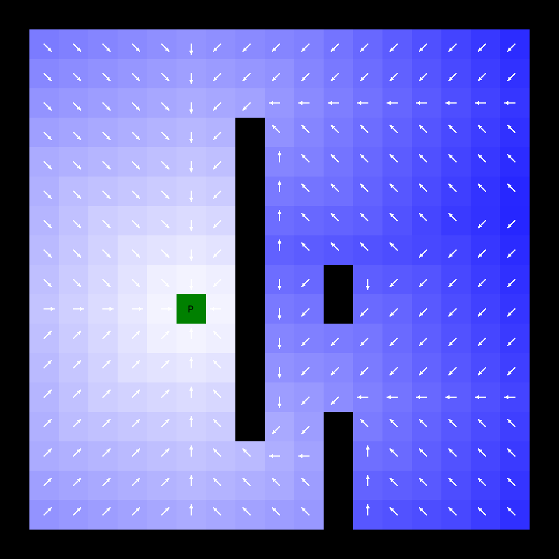
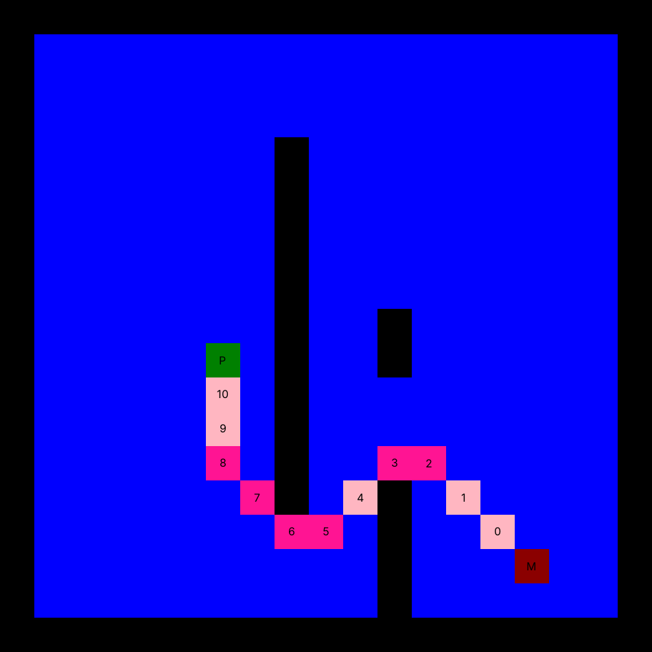

<p align="center">
  
</p>

<h1 align="center">NosCore.PathFinder</h1>

<p align="center">
  <a href="https://www.nuget.org/packages/NosCore.PathFinder/"></a>
  <a href="https://github.com/NosCoreIO/NosCore.PathFinder/actions/workflows/dotnet.yml"></a>
  <a href="https://discord.gg/Eu3ETSw"></a>
  <a href="LICENSE"></a>
</p>

Path finding on NosTale maps: brushfire distance maps, flow fields for many walkers heading to one goal, and jump point
search for a single path.

## Install

```bash
dotnet add package NosCore.PathFinder
```

## Algorithms

Each page below is generated by the tests and shows the algorithm's output on a real map.

- [Brushfire](documentation/BrushFireTests.Test_BrushFire.approved.md)
- [Flow field](documentation/FlowFieldTests.Test_FlowField.approved.md), and
  [a monster following it](documentation/FlowFieldTests.Test_FlowField_MonsterPath.approved.md)
- [Goal-based path finder](documentation/GoalBasedPathfinderTests.Test_GoalBasedPathfinder.approved.md)
- [Jump point search](documentation/JumpPointSearchPathfinderTests.Test_JumpPointSearchPathfinder.approved.md)

<p align="center">
  
  
</p>

## Visualizer

`src/NosCore.PathFinder.Api` is a small web app, not part of the package, that draws the algorithms on any map and
times them. Without a database it shows a few built-in sample maps. To see the game's maps, fill a NosCore database with
the parser first, as described in NosCore's
[getting started guide](https://github.com/NosCoreIO/NosCore/blob/master/documentation/getting-started.md); the
visualizer connects to `localhost:5432` with user `postgres` and password `password` by default.

```bash
dotnet run --project src/NosCore.PathFinder.Api
```

## Building

```bash
dotnet build
dotnet test
```

## Contributing

Questions, ideas and pull requests are welcome; most of the discussion happens on [Discord](https://discord.gg/Eu3ETSw).
Any editor that handles .NET 11 works: `dotnet build` and `dotnet test` run on Windows, Linux and macOS.
In Visual Studio, [Roslynator](https://github.com/dotnet/roslynator) and
[ReSharper](https://www.jetbrains.com/resharper/) help keep to the code style.

## Supporting NosCore

NosCore is a spare-time open source project. Sponsoring buys time spent on the emulator and the packages around it,
and gives the **Supporter** role on Discord.

<p>
  <a href="https://github.com/sponsors/0Lucifer0"></a>
  <a href="https://ko-fi.com/A3562BQV"></a>
  <a href="https://www.patreon.com/bePatron?u=6503887"></a>
</p>

Thanks to [Navicat](https://www.navicat.com) for supporting the project.

<a href="https://www.navicat.com"></a>

## Legal

NosCore is an independent, unofficial project for educational use. It is not affiliated with, authorized, maintained,
sponsored or endorsed by Gameforge or any of its affiliates; NosTale is a trademark of Gameforge. Using it may be
against the terms of service of NosTale servers.

Released under the [MIT License](LICENSE).
